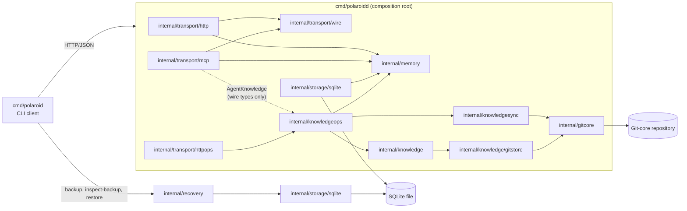

# Architecture overview

Polaroid stores procedures that agents find, follow, and correct. It manages generic records, versions, and (later) relationships and evidence. It never runs an LLM and never executes instructions: agents do that with their own tools. Task knowledge lives in record content; adding a task never changes code.

This page describes what is **implemented**: procedure identity and immutable versions (increment 1); repository bindings, named subprocedure references and the bounded composition graph (increment 2); and immutable execution records with child-execution links, derived context-specific verification and evidence-based contextual resolution ([#7](https://github.com/ashuangiras/polaroid/issues/7), [#9](https://github.com/ashuangiras/polaroid/issues/9), [#11](https://github.com/ashuangiras/polaroid/issues/11), [#13](https://github.com/ashuangiras/polaroid/issues/13), increment 3); and the MCP transport and immutable feedback reports about Polaroid itself ([#15](https://github.com/ashuangiras/polaroid/issues/15), [#16](https://github.com/ashuangiras/polaroid/issues/16), increment 4); and toil items, versioned assessments of repetitive work ([#87](https://github.com/ashuangiras/polaroid/issues/87), [ADR-0034](decisions/0034-toil-items.md)); and the first increment of the catalog lifecycle, execution-evidence invalidation and procedure retirement, kept as append-only metadata beside the immutable records ([#91](https://github.com/ashuangiras/polaroid/issues/91), [ADR-0035](decisions/0035-evidence-invalidation-and-procedure-retirement.md)); and read-only catalog statistics, aggregated in one snapshot ([#96](https://github.com/ashuangiras/polaroid/issues/96), [ADR-0036](decisions/0036-read-only-catalog-statistics.md)); and byte limits on every new write, enforced in the domain and reported by the statistics ([#98](https://github.com/ashuangiras/polaroid/issues/98), [ADR-0037](decisions/0037-size-limits-on-new-writes.md)). Planned components are listed at the end and in the [roadmap](../development/roadmap.md).

## Components and dependency direction

One Go module, one repository. Dependencies point inward to the domain:

| Component | Contract | Depends on |
| --- | --- | --- |
| `internal/memory` | Record types, validation, version rules, `Service`, and the `Store` interfaces it needs, including ephemeral walkthrough, legacy proposal and field-complete draft event stores | Standard library only (`uuid`, `encoding/json/jsontext`) |
| `internal/storage/sqlite` | Implements `memory.Store` and runtime draft stores: atomic writes, canonical-key and binding-name uniqueness, immutability, migrations | `memory`, `database/sql`, `modernc.org/sqlite` |
| `internal/transport/http` | The [HTTP API](http-api.md): parsing, JSON-shape checks, error mapping, security checks | `memory`, `wire`, `net/http` |
| `internal/transport/mcp` | The [MCP server](mcp.md) at `/mcp`: tools, resources, strict argument decoding | `memory`, `wire`, the MCP Go SDK |
| `internal/transport/wire` | Record and error JSON shapes, strict decoding and error classification, shared by both transports so they cannot drift | `memory` |
| `cmd/polaroidd` | Configuration, including the database location (the per-user default and its private directories, [ADR-0025](decisions/0025-per-user-default-database.md)) and the knowledge directory, sources policy and operator token (their own per-user defaults, [ADR-0048](decisions/0048-git-native-agent-interface.md)), wiring, listener, timeouts, graceful shutdown | all of the above, plus `knowledgeops`, `gitcore`, `knowledge`, `knowledgesync` and `transport/httpops` below: the only composition root for both knowledge paths |
| `cmd/polaroid` | Generic CLI over the HTTP API, the local lifecycle commands, and the local catalog commands `backup`, `inspect-backup` and `restore`, which open the database files in the `polaroid` process ([ADR-0030](decisions/0030-catalog-backup-and-restore.md)) | Standard library, `lifecycle`, `recovery`, `version`; never storage or `memory` directly |
| `internal/lifecycle` | Per-user installation and the managed service: layout, launchd and systemd definitions and adapters, ownership-aware status, staged install, upgrade and uninstall ([ADR-0026](decisions/0026-per-user-installation-and-managed-service.md)) | Standard library, `version` |
| `internal/recovery` | Catalog backup (consistent `VACUUM INTO` snapshot, validated, published atomically with versioned metadata), inspection, and restore (plan, staged copy, recovery backup, managed-service coordination, atomic replacement, rollback) ([ADR-0030](decisions/0030-catalog-backup-and-restore.md)) | `storage/sqlite`, `lifecycle`, `version` |
| `internal/version` | The build identity embedded by the Go toolchain | Standard library only |
| `internal/gitcore` | Knowledge snapshots in a bare Git repository: atomic, durable publication of files under one active ref, published-snapshot reads, history with provenance trailers, diff, verification and recovery ([ADR-0044](decisions/0044-git-core.md)); fetch into a bounded quarantine, verification and import of received snapshots, fast-forward activation with a local journal, and fast-forward-only push over local, HTTPS and SSH remotes ([ADR-0046](decisions/0046-git-knowledge-synchronisation.md)); no procedure rules | go-git (objects, storage, `file`/`http`/`ssh` transports), standard library |
| `internal/knowledge` | The Git-native knowledge path: procedures under stable canonical keys as canonical documents, catalogs read from one snapshot, composition by key, whole-catalog validation (references, applicability, cycles, limits), field-complete review-receipt validation, publication with provenance, rollback, history and deterministic discovery, all through a `Store` port ([ADR-0045](decisions/0045-living-knowledge-kernel.md), [ADR-0062](decisions/0062-field-complete-knowledge-publication.md)). Reached from the daemon only through `internal/knowledgeops`; the legacy `memory`/SQLite path is unchanged and separate ([ADR-0048](decisions/0048-git-native-agent-interface.md)) | Standard library only |
| `internal/knowledge/gitstore` | The knowledge `Store` on Git-core: snapshots are commits, the kernel's check runs inside Git-core's publication and activation, Git-core errors map to the kernel's | `knowledge`, `gitcore` |
| `internal/knowledgesync` | Knowledge exchange between instances: the explicit trust policy (sources, publishers, publish permission), fetch, validation of every incoming publication and local push history (Git integrity, publisher, rationale, complete catalog and field-review receipts), acceptance, divergence classification and activation through the kernel ([ADR-0046](decisions/0046-git-knowledge-synchronisation.md), [ADR-0062](decisions/0062-field-complete-knowledge-publication.md)) | `knowledge`, `knowledge/gitstore`, `gitcore` |
| `internal/knowledgeops` | Orchestrates the knowledge path for both interfaces ([ADR-0048](decisions/0048-git-native-agent-interface.md)): `Agent`, `Resolver`, `Guide`, legacy v4/v5 proposal rejection, `FieldDrafter` (every type-applicable field, explicit operations, complete current values, receipt-backed publication; [ADR-0062](decisions/0062-field-complete-knowledge-publication.md)) and `Operator` (status, v2 publish/rollback, fetch, validate, activate, push, activations, reconcile). No knowledge persistence or versioning of its own; ephemeral draft events use `memory` and SQLite | `knowledge`, `knowledgesync`, `gitcore`, `memory`, `reasoning`, `wire` |
| `internal/transport/httpops` | The token-authenticated operator surface: v1 knowledge reads and remote operations plus v2 receipt-bearing publication and rollback routes ([http-api.md](http-api.md#git-native-knowledge-operator-api)); no scheduler | `knowledgeops`, `wire`, `net/http` |

Each internal package is tested on its own against its contract: validation rules in `memory`, persistence and concurrency in `storage/sqlite` (real database files), and the full stack through real HTTP in `transport/http` and `transport/mcp` (the latter through the SDK's own client). `internal/archtest` fails the build if `memory` imports HTTP, SQL or storage code, if storage imports transport, if a transport imports storage, or if the two transports import each other. It also keeps `lifecycle` free of storage and `recovery`, and allows `cmd/polaroid` to reach storage only through `recovery`. It keeps `gitcore` free of `memory`, `knowledge`, transports, SQL and `recovery`; keeps `knowledge` free of Git, SQL, storage, transports and `memory`; limits `knowledge/gitstore` to `knowledge` and `gitcore`, and `knowledgesync` to those three; keeps `knowledgeops` and `httpops` free of storage, and keeps the legacy `transport/http` and `transport/mcp` packages free of `knowledge`, `knowledgesync`, `gitcore` and `knowledgeops` (`internal/transport/mcp` reaches `knowledgeops.Agent` only through its own `AgentKnowledge` interface, expressed in `wire` types, so its own dependency footprint never changes); and keeps every legacy package (`memory`, storage, `transport/http`, `recovery`, `lifecycle`, both commands) free of `knowledge`, `knowledgesync`, `gitcore` and `knowledgeops`, so no knowledge is written to both stores.

There is deliberately one interface (`memory.Store`): it lets the domain stay ignorant of SQLite. No other abstraction exists until a second implementation or a test needs one.

## Request flow

1. `polaroidd` accepts a request; the server enforces header/read/write timeouts.
2. `transport/http` applies the loopback-host check (when bound to loopback) and cross-origin protection, decodes the body strictly (1 MiB limit, unknown or duplicate members rejected), and calls `memory.Service`. Requests to `/mcp` pass the same checks, and `transport/mcp` decodes tool arguments with the same strict rules.
3. `memory.Service` validates the envelope, assigns IDs, version numbers and timestamps, and calls the `Store`.
4. `storage/sqlite` performs the write in one transaction, or the read in one statement.
5. Domain errors map to `400`/`404`/`409`; anything else is logged and returned as `500 internal` without detail.

## Consistency and concurrency

- **Writes** run in one transaction that takes SQLite's write lock at `BEGIN` (`_txlock=immediate`, `busy_timeout` 5s). Concurrent writers queue; none fails mid-transaction. A write that cannot take the lock within 5 seconds (another process holds it, for example a `sqlite3` shell with an open write transaction) fails with `500 internal`, stores nothing, and can be retried. Reads keep answering meanwhile.
- **Storage failures** (a full disk, an I/O error) abort the whole transaction: the client gets `500 internal`, the cause is logged, and no part of the write is stored.
- **Shutdown**: on SIGINT or SIGTERM the daemon stops accepting connections and lets in-flight requests finish (up to 10 seconds). A write answered `201` is stored; a request the daemon no longer accepted gets a connection error and stores nothing.
- **Concurrent creations and appends**: of concurrent creations under one canonical key (or registrations of one repository identifier) exactly one is stored and the others get `409`.
- **Revisions** carry the base version they were derived from. The store checks "base equals latest" and inserts `latest + 1` inside that transaction, so of N concurrent revisions from one base exactly one succeeds and the rest get `409 version_conflict`. Nothing is merged or overwritten. Binding revisions follow the same rule with `base_revision` and `409 revision_conflict`.
- **Reads** are single SQL statements, so a history is always one consistent snapshot (WAL mode lets reads proceed during writes). The composition graph, verification and resolution need one query per node, so they read inside one read-only transaction instead: one snapshot, fixed when the read begins, without the write lock ([ADR-0039](decisions/0039-read-only-snapshot-transactions.md)). They answer while a writer holds the lock, and see none of its uncommitted rows.
- **Integrity backstops in the schema**: unique canonical keys, `(repository, name)` pairs and repository identifiers; triggers reject any `UPDATE` or `DELETE` of procedures, versions, bindings, binding revisions, executions and their child links, feedback reports, repositories, repository identifiers and procedure origins, and toil items, revisions and their links, any non-contiguous version or revision number, a toil status transition outside the lifecycle, a pin to a version that does not exist, an execution that does not match its binding revision, and a child link that does not fulfil its reference; a reference row can be written only in the same transaction as its new version (a trigger plus a deferred foreign key); `CHECK` constraints require `contract`, `instructions` and `inputs` to be JSON objects and keep identifiers in their canonical formats. These hold even for a client that bypasses `polaroidd`.
- **Durability**: `synchronous=FULL`. Schema migrations run in a write transaction at startup; a database newer than the binary is refused. By default the database is `~/.polaroid/data/polaroid.db`, outside any repository or build output, so build cleanup and binary upgrades cannot remove it ([ADR-0025](decisions/0025-per-user-default-database.md)).

## Security posture

There is no authentication or authorization yet ([ADR-0006](decisions/0006-local-unauthenticated-api.md)). The daemon listens on `127.0.0.1:7417` by default, and then:

- rejects requests whose `Host` is not a loopback name (blocks DNS rebinding from web pages);
- rejects unsafe cross-origin browser requests (`net/http.CrossOriginProtection`);
- requires `Content-Type: application/json` on writes and limits bodies to 1 MiB;
- never returns internal error text.

Binding to a non-loopback address is possible (`-addr`) but logs a warning: anyone who can reach the port can read and write records. Access control is planned.

## Planned components (not implemented)

The agent interface on the knowledge kernel and migration from the SQLite catalog are planned as milestones D–E of [ADR-0044](decisions/0044-git-core.md). See the [roadmap](../development/roadmap.md).
